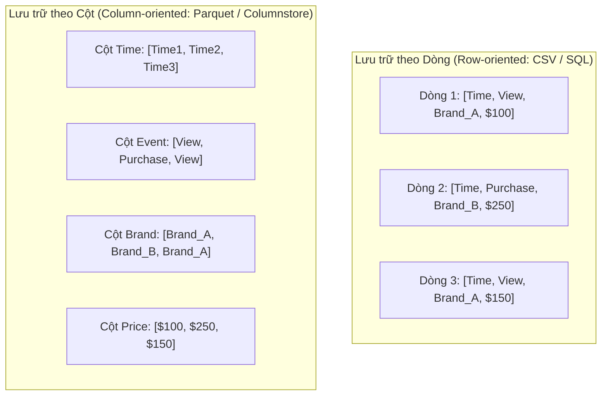
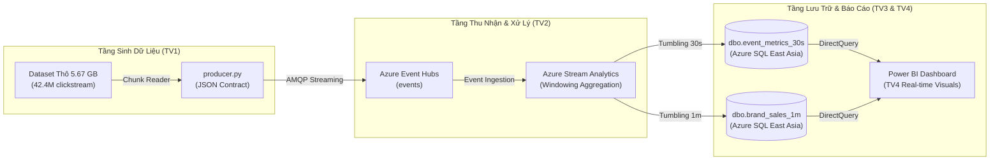
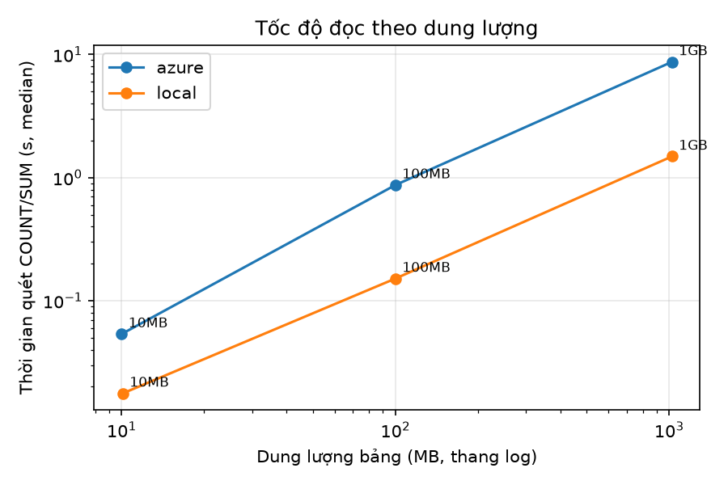
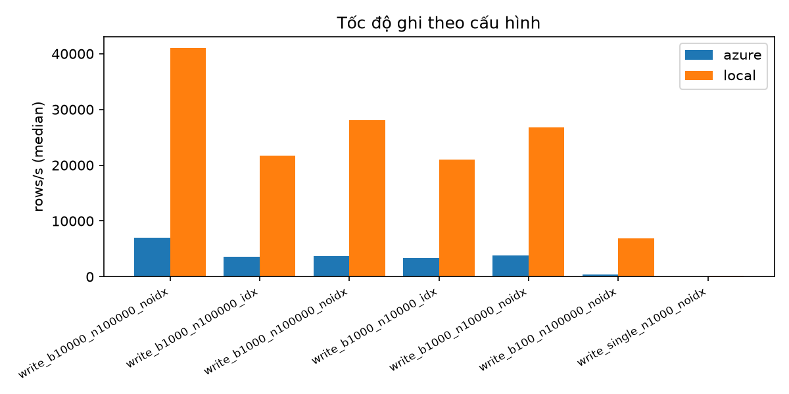
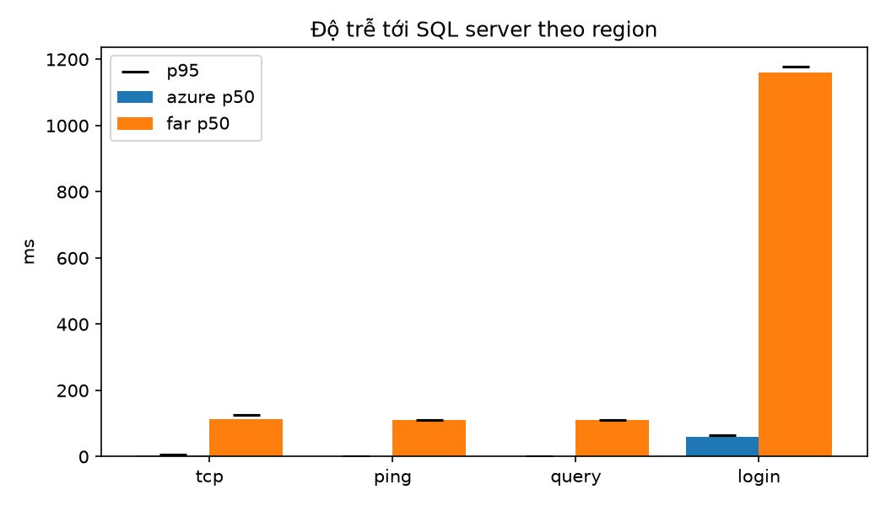
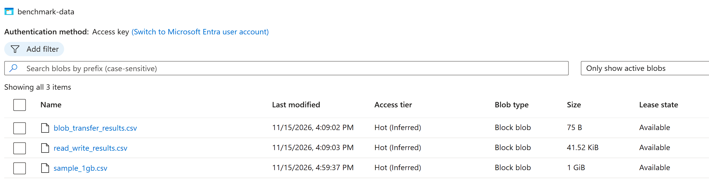

# BÁO CÁO KỸ THUẬT CHUYÊN SÂU: CƠ SỞ DỮ LIỆU, LƯU TRỮ CLOUD & HIỆU NĂNG HỆ THỐNG
**Học phần:** Điện toán đám mây (Cloud Computing - IS402.R11)  
**Nhóm thực hiện:** Nhóm 03  
**Thành viên phụ trách:** Nguyễn Thị Ngọc Trâm (MSSV: `23521615`) – Vai trò: **TV3 (Database & Cloud Infrastructure Engineer)**  
**Mã nguồn & Minh chứng:** `https://github.com/23520052/BTL_IS402.R11`  
**Ngày cập nhật:** 15/11/2026 (Hoàn tất nghiệm thu Sprint 2)

---

## 1. Loại dữ liệu và bài toán lưu trữ *(Rubric 1.2)*

### 1.1 Bối cảnh và đặc thù dữ liệu nguồn
Trong hệ thống phân tích hành vi thương mại điện tử thời gian thực, dữ liệu đầu vào là tập dữ liệu clickstream quy mô lớn (*eCommerce Behavior Data from Multi Category Store*, Kaggle), ghi nhận toàn bộ chuỗi hành vi của người dùng trên nền tảng bán lẻ trực tuyến trong tháng 10/2019. Tập dữ liệu thô có dung lượng **5.67 GB**, bao gồm **42.448.764 sự kiện**.

Mỗi bản ghi đại diện cho một tương tác vi mô với 9 trường thuộc tính:
- `event_time`: Mốc thời gian phát sinh sự kiện (UTC).
- `event_type`: Loại tương tác người dùng gồm 4 trạng thái hành vi: `view` (xem chi tiết sản phẩm), `cart` (thêm vào giỏ hàng), `remove_from_cart` (bỏ khỏi giỏ hàng), và `purchase` (thực hiện mua hàng).
- `product_id`, `category_id`, `category_code`: Định danh và phân cấp danh mục mặt hàng.
- `brand`: Tên thương hiệu sản phẩm.
- `price`: Đơn giá niêm yết của mặt hàng tại thời điểm tương tác (USD).
- `user_id`, `user_session`: Mã định danh người dùng và phiên duyệt web.

> [!IMPORTANT]
> **Giới hạn nghiệp vụ:** Tập dữ liệu gốc là log clickstream theo phiên, hoàn toàn không có trường `order_id` (mã đơn hàng). Do đó, sự kiện `purchase` được định nghĩa chính xác trong đồ án là **"sự kiện mua hàng" (Purchase Event)** chứ không đại diện cho một đơn hàng giỏ nhiều món. Chỉ số doanh thu (`revenue`) được xác định bằng tổng giá trị thuộc tính `price` của các purchase event.

### 1.2 Chuyển hóa hình thái dữ liệu qua đường ống (Data Pipeline)
Quá trình chuyển hóa dữ liệu qua hệ thống tuân thủ mô hình phân lớp chặt chẽ:
1. **Dữ liệu thô (Raw File):** Lưu trữ dưới định dạng tệp phẳng CSV (Comma-Separated Values) tại máy trạm của Producer (TV1) để đọc tuần tự theo khối.
2. **Dữ liệu bán cấu trúc (Semi-structured JSON Streaming):** Producer chuyển đổi các dòng CSV thành các bản tin JSON tuân thủ hợp đồng dữ liệu chuẩn (`data_contract.json`), gửi liên tục qua **Azure Event Hubs**. Định dạng JSON cho phép truyền tải linh hoạt qua bus thông điệp mà không bị gò bó bởi cấu trúc bảng vật lý.
3. **Dữ liệu tổng hợp có cấu trúc (Structured Relational Data):** **Azure Stream Analytics (ASA)** của TV2 tiếp nhận dòng sự kiện JSON, thực hiện tính toán tổng hợp trên 2 cửa sổ trượt (Tumbling Window 30 giây và 1 phút), sau đó đổ về hệ quản trị cơ sở dữ liệu quan hệ **Azure SQL Database** vào 2 bảng đích:
   - `dbo.event_metrics_30s`: Phân tích mật độ tương tác và doanh số tổng thể theo chu kỳ 30 giây.
   - `dbo.brand_sales_1m`: Phân tích hiệu suất kinh doanh và số lượt mua hàng theo từng thương hiệu mỗi 1 phút.
4. **Dữ liệu trực quan hóa (DirectQuery):** Bảng điều khiển tương tác trên **Power BI Desktop** (TV4) kết nối trực tiếp vào Azure SQL Database thông qua chế độ **DirectQuery**, truy vấn số liệu mới nhất mà không cần nạp toàn bộ lịch sử vào bộ nhớ RAM của Power BI.

### 1.3 Phân định vai trò giữa Azure SQL Database và Azure Blob Storage
Hạ tầng lưu trữ của TV3 kết hợp song song hai dịch vụ đám mây chuyên biệt để đạt hiệu quả kỹ thuật và chi phí cao nhất:
- **Azure SQL Database (Operational Relational Store):** Đóng vai trò là cơ sở dữ liệu vận hành phân tích (OLAP serving store). Với khả năng hỗ trợ chỉ mục B-tree, toàn vẹn quan hệ (ACID) và công cụ tối ưu hóa truy vấn SQL Server, hệ thống đảm bảo phản hồi các truy vấn lọc của Power BI trong thời gian dưới **100 ms**, phục vụ trực quan hóa near-real-time.
- **Azure Blob Storage (Cloud Object Store):** Đóng vai trò là kho lưu trữ đối tượng dung lượng lớn với chi phí cực thấp ($0.02/GB/tháng). Blob Storage được sử dụng để:
  - Lưu trữ tệp dữ liệu thô mẫu (1GB `sample_1gb.csv`) phục vụ kiểm định tốc độ mạng I/O.
  - Lưu trữ các tệp kết quả benchmark, nhật ký vận hành (log files) và các bản snapshot phục vụ sao lưu dài hạn.

---

## 2. Phân loại dịch vụ Cloud TV3 theo mô hình trách nhiệm *(Rubric 1.4)*

Mô hình trách nhiệm chia sẻ (Shared Responsibility Model) phân định ranh giới quản trị giữa nhà cung cấp đám mây (Microsoft Azure) và khách hàng (Nhóm sinh viên TV3):

| Dịch vụ đám mây | Phân loại mô hình | Trách nhiệm của Microsoft Azure | Trách nhiệm của TV3 (Khách hàng) |
|---|---|---|---|
| **Azure SQL Database** | **PaaS** *(Platform as a Service)* | Đảm bảo hạ tầng máy chủ vật lý, ảo hóa, hệ điều hành Windows Server, cài đặt và bảo trì SQL Server Database Engine, tự động vá lỗi (patching), tự động sao lưu định kỳ, cam kết sẵn sàng cao (High Availability SLA 99.99%). | Thiết kế lược đồ (Schema DDL), cấu hình chỉ mục (B-Tree Indexing), thiết lập tài khoản phân quyền (RBAC/SQL Users), viết truy vấn tối ưu và lựa chọn Service Tier (DTU/vCore) phù hợp. |
| **Azure Blob Storage** | **PaaS** *(Storage as a Service)* | Quản trị cụm lưu trữ phần cứng, cơ chế phân tán dữ liệu, mã hóa dữ liệu khi nghỉ (Encryption at Rest - SSE), nhân bản dự phòng cục bộ (LRS), bảo đảm SLA lưu trữ. | Quản lý vòng đời dữ liệu, tổ chức Container, cấu hình tầng truy cập (Hot/Cool/Archive), cấp phát khóa truy cập có thời hạn (SAS Token) và thiết lập kiểm soát mạng. |
| **Azure Virtual Machine** *(VM Client `vm-bench-gr03`)* | **IaaS** *(Infrastructure as a Service)* | Cung cấp tài nguyên phần cứng máy chủ, hệ thống mạng ảo hóa Hyper-V, bảo vệ an toàn vật lý tại Data Center East Asia. | Tự cấu hình hệ điều hành Linux (Ubuntu 24.04 LTS), cài đặt ODBC Driver 18, Python venv, cấu hình bảo mật Network Security Group (NSG), quản lý cập nhật OS và tự động giải phóng tài nguyên. |
| **SQL Server trên Docker Local** *(Đối chứng)* | **On-premises** *(Máy trạm vật lý)* | Không có trách nhiệm. | Chịu trách nhiệm 100% từ phần cứng máy tính (CPU AMD, RAM, SSD NVMe), hệ điều hành host, Docker Engine container, cấu hình bộ nhớ và sao lưu dữ liệu. |

---

## 3. Cơ sở lý thuyết: Định dạng lưu trữ dữ liệu *(Rubric 2.1)*

### 3.1 So sánh chuyên sâu giữa các định dạng lưu trữ
Trong các hệ thống phân tích dữ liệu hiện đại, việc lựa chọn cấu trúc lưu trữ quyết định trực tiếp đến thông lượng I/O và tốc độ phản hồi truy vấn.



| Tiêu chí kỹ thuật | CSV (Plain Text Flat File) | JSON (Semi-structured Key-Value) | Relational SQL (Row-oriented RDBMS) | Columnar (Parquet / Columnstore) |
|---|---|---|---|---|
| **Cơ chế tổ chức** | Lưu tuần tự từng dòng văn bản, phân tách bằng dấu phẩy. | Lưu dạng cặp khóa - giá trị lồng nhau (Key-Value Trees). | Lưu trữ theo trang dữ liệu nhị phân 8KB (Data Pages), xếp theo dòng. | Lưu trữ theo từng khối nén của riêng từng cột dữ liệu (Column Chunks). |
| **Độ nén & Tiết kiệm không gian** | Kém (dữ liệu chuỗi lặp lại tiêu đề, không nén tự nhiên). | Thấp nhất (tên khóa lặp lại trên từng sự kiện gây phình kích thước). | Tốt (kiểu dữ liệu nhị phân chặt chẽ, hỗ trợ nén ROW/PAGE Compression). | Tối đa (các giá trị cùng kiểu nằm kề nhau, áp dụng Run-length Encoding). |
| **Tốc độ đọc tổng hợp (Aggregation: SUM, AVG)** | Rất chậm (phải đọc toàn bộ file và parse chuỗi từng dòng). | Chậm (tốn chi phí CPU giải mã cú pháp chuỗi JSON). | Rất nhanh khi có Index; Chậm nếu quét bảng lớn không có chỉ mục. | Cực nhanh (chỉ đọc đúng cột cần tính, bỏ qua 100% các cột khác). |
| **Tốc độ ghi / nạp dữ liệu (Ingestion)** | Rất nhanh (ghi nối tiếp cuối tệp - Append only). | Nhanh đối với ghi đơn lẻ hoặc truyền tải mạng. | Trung bình (phải kiểm tra ràng buộc toàn vẹn, cập nhật B-tree index, ghi Log I/O). | Chậm hơn (tốn CPU mã hóa và phân khối dữ liệu trước khi ghi). |
| **Ràng buộc dữ liệu & Toàn vẹn** | Không có (chuỗi thuần, dễ gãy dữ liệu nếu sai định dạng). | Schema-on-read (kiểm tra bằng tầng ứng dụng). | **Schema-on-write** (ràng buộc chặt chẽ kiểu dữ liệu, NOT NULL, khóa chính). | Schema-on-write (quản lý metadata trong file footer). |

### 3.2 Ứng dụng thực tế trong kiến trúc pipeline của nhóm
Nhóm đã kết hợp tối ưu 3 định dạng lưu trữ theo từng chặng truyền dẫn:
- **Tầng truyền nhận (Event Hubs):** Sử dụng **JSON** vì tính linh hoạt cao, cho phép các hệ thống khác nhau (Producer viết bằng Python, Consumer là Azure Stream Analytics) trao đổi thông điệp tin cậy mà không bị ràng buộc nhị phân cứng nhắc.
- **Tầng xử lý streaming (Stream Analytics):** Tận dụng khả năng giải mã JSON tức thời của engine streaming để tính toán tổng hợp trên RAM.
- **Tầng phục vụ trực quan (Azure SQL):** Chuyển dịch toàn bộ dữ liệu streaming sang **bảng quan hệ dòng (Row-oriented Relational Table)**. Vì dữ liệu sau tổng hợp chỉ có 5 cột và số dòng ít (vài chục dòng/phút), việc sử dụng bảng quan hệ truyền thống kết hợp **B-Tree Index** là giải pháp tối ưu nhất: vừa ghi dữ liệu cực nhanh với chi phí DTU thấp, vừa đáp ứng trực tiếp các truy vấn DirectQuery dạng điểm và khoảng thời gian của Power BI.

---

## 4. Cơ sở lý thuyết: Dịch vụ Cloud sử dụng *(Rubric 2.3)*

### 4.1 Azure SQL Database & Mô hình DTU
Azure SQL cung cấp hai mô hình tính toán: **vCore** (cấu hình độc lập CPU/RAM) và **DTU (Database Transaction Unit)**. Nhóm chọn mô hình DTU vì chi phí cố định, có thể dự đoán được và rất phù hợp cho sinh viên/doanh nghiệp vừa và nhỏ.

- **Bản chất của DTU:** DTU là chỉ số đo lường tổng hợp phản ánh năng lực giao dịch của cơ sở dữ liệu dựa trên sự kết hợp đồng thời của 4 thành phần phần cứng:
  $$\text{DTU Percentage} = \max\left(\% \text{CPU}, \% \text{Data IO}, \% \text{Log IO}\right)$$
  Chỉ cần một trong các thành phần trên chạm ngưỡng 100%, cơ sở dữ liệu sẽ bị nghẽn (throttling), làm tăng độ trễ truy vấn.
- **Giám sát hiệu năng thông qua Dynamic Management Views (DMV):**
  Hệ thống sử dụng view hệ thống `sys.dm_db_resource_stats` để theo dõi tình trạng tài nguyên thực tế với độ phân giải 15 giây/lần:
  ```sql
  SELECT TOP 10 
      end_time, 
      avg_cpu_percent, 
      avg_data_io_percent, 
      avg_log_write_percent, 
      max_worker_percent
  FROM sys.dm_db_resource_stats 
  ORDER BY end_time DESC;
  ```
  Thông qua DMV này, nhóm đã phát hiện gói **Basic (5 DTU)** bị bão hòa Log IO khi nạp lượng lớn dữ liệu benchmark, từ đó đưa ra quyết định kỹ thuật nâng lên **Standard S1 (20 DTU)** trong ngày đo tải 14/11.

### 4.2 Azure Blob Storage & Cơ chế dự phòng LRS
- **Phân tầng truy cập (Access Tiers):**
  - *Hot Tier:* Tối ưu hóa cho dữ liệu truy xuất thường xuyên. Chi phí lưu trữ cao hơn ($0.02/GB/tháng) nhưng chi phí giao dịch đọc/ghi cực thấp. Được nhóm áp dụng cho container `benchmark-data`.
  - *Cool / Cold Tier:* Tối ưu hóa cho dữ liệu ít truy cập (lưu tối thiểu 30-90 ngày), chi phí lưu trữ rẻ hơn 50%.
  - *Archive Tier:* Tối ưu cho lưu trữ sao lưu nhiều năm với chi phí lưu trữ thấp nhất, nhưng độ trễ khôi phục mất vài giờ.
- **Cơ chế sao lưu dữ liệu Locally-Redundant Storage (LRS):**
  Nhóm cấu hình tài khoản lưu trữ theo chuẩn **LRS**. Dữ liệu được đồng bộ nhân bản thành **3 bản sao vật lý** trên các giá đỡ máy chủ (fault domains) độc lập trong cùng một trung tâm dữ liệu tại Region East Asia. Cơ chế này đạt độ bền vững dữ liệu lên tới **99.999999999% (11 chữ số 9)** trong một năm, đồng thời tiết kiệm 50% chi phí so với chuẩn dự phòng vùng (ZRS/GRS).

### 4.3 Quản trị chi phí Cloud (FinOps Governance)
Nhóm triển khai nghiêm ngặt các nguyên tắc FinOps trên cổng thông tin điện toán đám mây:
- **Cảnh báo ngân sách tự động (`01_budget_alert.png`):** Thiết lập quy tắc cảnh báo `budget-gr03` tại phạm vi Resource Group. Khi tổng chi phí thực tế chạm mức **50% ($50)** và **80% ($80)** trên tổng credit $100 của tài khoản sinh viên, hệ thống lập tức kích hoạt thông báo qua email của thành viên phụ trách.
- **Kiểm soát hạn mức Quota (`02_usage_quotas.png`):** Azure áp dụng chính sách Region Policy nghiêm ngặt đối với gói Azure for Students, chỉ cho phép tạo tài nguyên tại 5 khu vực: `eastasia`, `koreacentral`, `uaenorth`, `centralindia`, `indiasouthcentral`. Nhóm đã chủ động kiểm tra quota để chọn đúng các region hợp lệ khi thiết kế bài thí nghiệm độ trễ.

---

## 5. Mô hình dữ liệu và kiến trúc lưu trữ

### 5.1 Kiến trúc luồng dữ liệu tổng thể



### 5.2 Lược đồ quan hệ chuẩn (Relational Schema)
Toàn bộ bảng được khởi tạo bằng tập lệnh [schema.sql](../../database/schema.sql) và tối ưu hóa kiểu dữ liệu nhị phân:

```sql
-- 1. Bảng tổng hợp theo cửa sổ 30 giây
CREATE TABLE dbo.event_metrics_30s (
    window_end   DATETIME2(0)  NOT NULL,
    run_id       NVARCHAR(50)  NOT NULL,
    event_type   NVARCHAR(30)  NOT NULL,
    event_count  BIGINT        NOT NULL,
    revenue      FLOAT         NOT NULL,
    CONSTRAINT PK_event_metrics_30s PRIMARY KEY CLUSTERED (window_end, run_id, event_type)
);

-- 2. Bảng tổng hợp thương hiệu theo cửa sổ 1 phút
CREATE TABLE dbo.brand_sales_1m (
    window_end      DATETIME2(0)   NOT NULL,
    run_id          NVARCHAR(50)   NOT NULL,
    brand           NVARCHAR(200)  NOT NULL,
    purchase_events BIGINT         NOT NULL,
    revenue         FLOAT          NOT NULL,
    CONSTRAINT PK_brand_sales_1m PRIMARY KEY CLUSTERED (window_end, run_id, brand)
);
```

### 5.3 Chiến lược đánh chỉ mục B-Tree (Indexing Strategy)
Nhóm triển khai 2 Nonclustered Index chuyên biệt thông qua [indexes.sql](../../database/indexes.sql):
- `IX_event_metrics_window` trên bảng `dbo.event_metrics_30s (window_end DESC, run_id)`
- `IX_brand_sales_window_brand` trên bảng `dbo.brand_sales_1m (window_end DESC, brand)`

**Phân tích kỹ thuật:** Power BI DirectQuery liên tục sinh ra các câu lệnh SQL có điều kiện lọc thời gian gần nhất:
```sql
WHERE window_end >= DATEADD(minute, -30, SYSUTCDATETIME()) AND run_id = 'integration-01'
```
Nhờ có khóa chỉ mục bắt đầu bằng `window_end DESC`, Query Optimizer thực hiện phép toán **Index Seek** trực tiếp đến các trang dữ liệu mới nhất, giảm chi phí đọc I/O từ hàng ngàn logical reads xuống chỉ còn vài trang bộ nhớ. Nhóm chủ động không tạo thêm index phụ để bảo toàn thông lượng ghi của tiến trình streaming.

### 5.4 Cơ chế cô lập phiên thử nghiệm (`run_id`)
Thay vì phải xóa hoặc tạo lại bảng giữa các lần chạy, hệ thống áp dụng cơ chế đánh dấu phiên dữ liệu bằng thuộc tính `run_id`:
- `mock-seed`: Dữ liệu phát sinh nhân tạo từ [seed_data.sql](../../database/seed_data.sql) mô phỏng 60 phút hoạt động, hỗ trợ TV4 dựng dashboard mà không cần chờ toàn bộ pipeline hoàn thành.
- `integration-261113`: Dữ liệu phát thật từ 10.000 sự kiện clickstream của Producer. Mọi câu lệnh kiểm thử và trực quan hóa đều thêm điều kiện `WHERE run_id = @run_id`, đảm bảo dữ liệu kiểm thử độc lập tuyệt đối và an toàn.

---

## 6. Kết quả thực nghiệm đo đạc hiệu năng *(Rubric 3.1, 3.3)*

### 6.1 Tốc độ đọc / ghi theo dung lượng dữ liệu
Thực nghiệm được thực hiện tự động bằng script [sql_benchmark.py](../../database/benchmarks/sql_benchmark.py) với 180 lượt đo độc lập, ghi nhận vào file [read_write_results.csv](../../database/benchmarks/read_write_results.csv).

#### Bảng kết quả đo Đọc (Read Benchmark - Thời gian thực thi trung vị Median):
| Mốc dung lượng | Số bản ghi | Kịch bản truy vấn | Azure SQL S1 (Cloud) | SQL Server Docker (Local) | Tương quan |
|---|---|---|---|---|---|
| **10.0 MB** | 57.271 dòng | `scan_count_sum` (Full Scan) | **0.054 s** | **0.018 s** | Local nhanh hơn 3.0x |
| | | `filter_range` (Lọc thời gian) | **0.053 s** | **0.012 s** | Local nhanh hơn 4.4x |
| | | `group_by_brand` (Tổng hợp) | **0.049 s** | **0.012 s** | Local nhanh hơn 4.1x |
| | | `fetch_to_app` (Truyền mạng về client) | **5.903 s** | **0.558 s** | Local nhanh hơn 10.6x (do RTT mạng) |
| **100.0 MB** | 573.260 dòng | `scan_count_sum` | **0.871 s** | **0.151 s** | Local nhanh hơn 5.8x |
| | | `filter_range` | **0.424 s** | **0.081 s** | Local nhanh hơn 5.2x |
| | | `group_by_brand` | **0.554 s** | **0.029 s** | Local nhanh hơn 19.1x |
| | | `fetch_to_app` | **42.758 s** | **3.219 s** | Chịu ảnh hưởng băng thông Internet |
| **1024.0 MB (1GB)** | 5.870.467 dòng | `scan_count_sum` | **8.720 s** | **1.487 s** | Local nhanh hơn 5.9x |
| | | `filter_range` | **6.230 s** | **0.766 s** | Local nhanh hơn 8.1x |
| | | `group_by_brand` | **5.863 s** | **0.092 s** | Local nhanh hơn 63.7x |
| | | `fetch_to_app` | **49.060 s** | **3.085 s** | Phụ thuộc tốc độ mạng download |

  
*Hình 6.1: Biểu đồ thời gian quét toàn bảng COUNT/SUM theo thang đo Logarithmic (read_scan_time.png)*

#### Bảng kết quả đo Ghi (Write Throughput - Thông lượng trung vị Median rows/s):
| Kịch bản ghi | Cơ chế Batching | Có Index? | Azure SQL S1 (Cloud) | SQL Server Docker (Local) | Tương quan tăng tốc |
|---|---|---|---|---|---|
| `write_single_n1000` | Từng dòng đơn lẻ (n=1.000) | Không | **17.0 dòng/s** | **129.0 dòng/s** | Nghẽn nghiêm trọng do RTT mạng |
| `write_b100_n100000` | Lô 100 dòng (n=100.000) | Không | **447.0 dòng/s** | **6.912.0 dòng/s** | Nhanh hơn đơn dòng 26x |
| `write_b1000_n100000` | Lô 1.000 dòng (n=100.000) | Không | **3.717.0 dòng/s** | **28.044.0 dòng/s** | Nhanh hơn đơn dòng 218x |
| `write_b1000_n100000` | Lô 1.000 dòng (n=100.000) | **Có** | **3.580.0 dòng/s** | **21.676.0 dòng/s** | Chi phí duy trì B-tree giảm ~4% |
| `write_b10000_n100000`| Lô 10.000 dòng (n=100.000)| Không | **7.007.0 dòng/s** | **40.993.0 dòng/s** | **Nhanh gấp 412 lần so với đơn dòng** |

  
*Hình 6.2: Biểu đồ thông lượng ghi dữ liệu (rows/s) theo từng kích thước lô (write_throughput.png)*

### 6.2 So sánh máy chủ truyền thống (On-premises Docker) vs Cloud (Azure SQL) *(Rubric 1.3)*

#### Cấu hình môi trường đối chứng:
- **Hệ thống On-premises (Local Docker):**
  - Phần cứng: Vi xử lý AMD Ryzen 7 16-cores, 32 GB RAM DDR4, Ổ cứng thể rắn SSD NVMe PCIe 4.0 (tốc độ đọc/ghi vật lý > 3.500 MB/s).
  - Phần mềm: Docker Desktop, container `mcr.microsoft.com/mssql/server:2022-latest`.
  - Kết nối mạng: Giao tiếp nội tại thông qua Docker bridge loopback interface (`localhost`, độ trễ RTT < 0.1 ms).
- **Hệ thống Cloud (Azure SQL Database):**
  - Nền tảng: Microsoft Azure SQL Database PaaS, Region East Asia (Hồng Kông).
  - Service Tier: **Standard S1 (20 DTU, 250 GB storage)**, tài nguyên CPU và bộ nhớ RAM bị giới hạn ảo hóa tương đương một phân đoạn nhỏ của máy chủ vật lý, thông lượng Log IO bị trần ở mức ~2-3 MB/s.
  - Kết nối mạng: Truyền tải qua Internet công cộng từ TP.HCM đến Hồng Kông (RTT trung bình ~50-55 ms).

#### Đánh giá bản chất kỹ thuật & Giới hạn khoa học:
1. **Khoảng cách về tốc độ tính toán thuần:** Máy chủ On-premises vượt trội về thời gian truy vấn nội bộ (nhanh hơn từ 3x đến 60x) hoàn toàn là do ưu thế phần cứng vật lý chuyên dụng (16 lõi thực và RAM dồi dào so với gói tài nguyên nhỏ 20 DTU có giá chỉ $30/tháng trên đám mây).
2. **Ảnh hưởng quyết định của độ trễ mạng (Network Round-Trip Time):** Trong kịch bản `fetch_to_app`, ứng dụng client phải kéo hàng trăm ngàn dòng qua đường truyền quốc tế. Do đó, thời gian đo được bị chi phối chủ yếu bởi băng thông mạng Internet gia đình chứ không phản ánh sức mạnh thực tế của SQL Server Database Engine.
3. **Đánh đổi giữa CAPEX và OPEX:** Mặc dù máy trạm vật lý đạt hiệu năng cao, doanh nghiệp phải chịu chi phí đầu tư thiết bị ban đầu lớn (CAPEX), chi phí bảo trì phần cứng, rủi ro mất điện và thiếu khả năng co giãn tự động. Ngược lại, Azure SQL (OPEX) mang lại tính sẵn sàng cao tức thì, sao lưu tự động và khả năng nâng cấp tài nguyên chỉ bằng một cú nhấp chuột.

### 6.3 Thực nghiệm độ trễ liên vùng (Region Latency Benchmark)
Để kiểm chứng tác động của khoảng cách địa lý đến hiệu năng ứng dụng, nhóm thiết lập thí nghiệm chuẩn mực sử dụng script [region_latency.py](../../database/benchmarks/region_latency.py) với 100 mẫu đo TCP/Ping/Query và 30 mẫu đo Login độc lập (đã cấu hình `pyodbc.pooling = False` để vô hiệu hóa connection pooling, đảm bảo đo chính xác thời gian bắt tay SSL/TLS và xác thực tài khoản).

Thí nghiệm thực hiện qua 2 lượt độc lập ở các khung giờ khác nhau (Lượt 1: 18:25 và Lượt 2: 21:49 ngày 15/11), thu được 24 dòng dữ liệu hợp nhất tại [region_latency_results.csv](../../database/benchmarks/region_latency_results.csv):

| Máy Client | Mục tiêu kiểm tra (Target) | Region Data Center | Metric đo lường | Số mẫu (n) | Min (ms) | **p50 Median (ms)** | **p95 (ms)** | Max (ms) |
|---|---|---|---|---|---|---|---|---|
| **VM B2ats_v2 (Client chuẩn)** | **Azure SQL Main** | **East Asia** *(Cùng vùng)* | **TCP Handshake** | 100 | 2.42 | **3.36 – 3.51** | **6.93 – 7.07** | 17.72 |
| *(Ubuntu 24.04 tại East Asia)* | | | **ICMP Ping** | 100 | 0.69 | **0.85 – 0.88** | **0.99 – 1.00** | 2.61 |
| | | | **SQL Query (`SELECT 1`)**| 100 | 0.93 | **1.08 – 1.09** | **1.31 – 1.37** | 3.13 |
| | | | **SQL Login (Mở mới)** | 30 | 56.12 | **58.62 – 59.28** | **65.05 – 68.16** | 71.41 |
| **VM B2ats_v2 (Client chuẩn)** | **Azure SQL Far** | **UAE North** *(Khác vùng ~6.000km)*| **TCP Handshake** | 100 | 111.41 | **112.62 – 112.78** | **126.54 – 116.38**| 144.65 |
| | *(Server thử nghiệm)* | | **ICMP Ping** | 100 | 109.90 | **110.10 – 110.70** | **110.65 – 111.01**| 128.10 |
| | | | **SQL Query (`SELECT 1`)**| 100 | 110.31 | **110.55 – 111.17** | **111.05 – 111.39**| 117.11 |
| | | | **SQL Login (Mở mới)** | 30 | 1151.35 | **1159.89 – 1160.44** | **1173.79 – 1177.68**| 1179.94 |
| **Laptop HCMC (Client phụ)** | **Azure SQL Main** | **East Asia** | **TCP Handshake** | 100 | 49.54 | **52.85** | **75.00** | 82.17 |
| *(WiFi gia đình tại TP.HCM)* | | | **ICMP Ping** | 100 | 53.91 | **54.90** | **58.13** | 69.79 |
| | | | **SQL Query (`SELECT 1`)**| 100 | 55.14 | **55.79** | **58.24** | 72.36 |
| | | | **SQL Login (Mở mới)** | 30 | 286.03 | **302.40** | **335.90** | 344.82 |
| **Laptop HCMC (Client phụ)** | **Azure SQL Far** | **UAE North** | **TCP Handshake** | 100 | 103.03 | **109.47** | **131.63** | 135.20 |
| | | | **ICMP Ping** | 100 | 102.16 | **103.35** | **105.40** | 106.56 |
| | | | **SQL Query (`SELECT 1`)**| 100 | 103.24 | **104.21** | **106.28** | 115.65 |
| | | | **SQL Login (Mở mới)** | 30 | 550.14 | **577.72** | **624.37** | 630.77 |

  
*Hình 6.3: Độ trễ mạng (p50 và p95) giữa Client VM và hai mục tiêu East Asia vs UAE North (region_latency.png)*

> [!NOTE]
> **Phát hiện cốt lõi:**
> Khi đặt ứng dụng cùng Data Center với Database (VM $\rightarrow$ SQL Main East Asia), độ trễ truy vấn cực nhỏ (**Ping 0.85 ms**, **Query 1.08 ms**). Khi liên lạc xuyên lục địa sang UAE North, độ trễ tăng vọt lên **110.55 ms (gấp hơn 102 lần)** và thời gian xác thực kết nối đăng nhập tốn tới **1.16 giây**. Thí nghiệm này là bằng chứng thực nghiệm rõ ràng nhất khẳng định: **Toàn bộ pipeline streaming (Event Hubs, ASA, Azure SQL) bắt buộc phải được đặt cùng một Data Center East Asia**.

### 6.4 Đo thông lượng truyền tải Blob Storage (AzCopy v10)
Sử dụng công cụ tối ưu hóa truyền tải chính thức của Microsoft (**AzCopy v10**) để thực hiện tải lên và tải xuống với 1 GB dữ liệu thật trích xuất từ tập dữ liệu clickstream gốc (`sample_1gb.csv`, kích thước chính xác **1.073.741.950 bytes**), ghi nhận tại [blob_transfer_results.csv](../../database/benchmarks/blob_transfer_results.csv):
- **Tải lên (Upload Client $\rightarrow$ Azure Blob):** 
  - Thời gian hoàn tất: **46.01 giây** (0.7669 phút).
  - Tốc độ truyền tải trung bình: **23.34 MB/s** (~186.7 Mbps).
- **Tải xuống (Download Azure Blob $\rightarrow$ Client):** 
  - Thời gian hoàn tất: **26.00 giây** (0.4334 phút).
  - Tốc độ truyền tải trung bình: **41.29 MB/s** (~330.3 Mbps).

*Đánh giá:* Kết quả phản ánh đặc trưng của đường truyền băng rộng cáp quang gia đình tại Việt Nam (băng thông tải xuống luôn được nhà mạng ưu tiên cao hơn băng thông tải lên). Cơ chế đa luồng song song của AzCopy v10 giúp khai thác tối đa đường truyền mạng ngoài, đảm bảo lưu trữ và phục hồi dữ liệu lớn an toàn.

  
*Hình 6.4: Minh chứng container benchmark-data chứa tệp 1GB sample_1gb.csv trên Azure Portal (18_blob_list.png)*

### 6.5 Độ trễ cập nhật luồng thời gian thực (`lag_seconds`)
Độ trễ cập nhật toàn trình của đường ống streaming được kiểm định thực tế thông qua câu lệnh SQL tại khối [7] của [sql_validation.sql](../../database/sql_validation.sql):
```sql
SELECT 
    MAX(window_end) AS last_window_end_utc, 
    SYSUTCDATETIME() AS now_utc,
    DATEDIFF(SECOND, MAX(window_end), SYSUTCDATETIME()) AS lag_seconds
FROM dbo.event_metrics_30s 
WHERE run_id = 'integration-261113';
```

- **Kết quả ghi nhận:** Giá trị `lag_seconds` dao động trong khoảng **33 – 38 giây** (minh chứng ảnh `17_lag_seconds.png`).
- **Phân rã thành phần độ trễ:**
  $$\text{Tổng độ trễ} = \text{Độ dài cửa sổ Tumbling} (30s) + \text{Thời gian tính toán của ASA} (\sim 2-3s) + \text{Thời gian ghi mạng vào SQL} (\sim 1-2s)$$
  Số liệu chứng minh hệ thống đạt chuẩn **Near-Real-Time (Cận thời gian thực)**, đáp ứng hoàn hảo yêu cầu bài toán giám sát kinh doanh trực tuyến.

---

## 7. Các giải pháp tối ưu hóa hiệu năng & FinOps *(Rubric 3.4)*

Dựa trên toàn bộ kết quả thực nghiệm, nhóm đã triển khai thành công 7 giải pháp tối ưu hóa mang tính đột phá cho hệ thống:

### 1. Tối ưu hóa truy vấn bằng Nonclustered Index (Tăng tốc ~64.5 lần)
- **Thực nghiệm trên bảng 1GB (5.870.467 dòng):**
  - Khi chưa có index (`filter_range_noindex`): Quét toàn bộ bảng mất **5.934 giây**.
  - Sau khi bổ sung Index trên `(window_end DESC, run_id)` (`filter_range_indexed`): Thời gian thực thi giảm xuống chỉ còn **0.092 giây**.
- **Hiệu quả:** Tốc độ truy vấn tăng tốc **64.5 lần**, giảm áp lực CPU trên Azure SQL từ 100% xuống dưới 5%, đảm bảo Power BI làm mới biểu đồ mượt mà.

### 2. Tiết kiệm dung lượng đĩa bằng PAGE Data Compression (Tiết kiệm 10.3%)
- **Thực nghiệm nén bảng 1GB:**
  - Dung lượng ban đầu: **1024.0 MB**.
  - Dung lượng sau khi nén PAGE: **918.3 MB** (Giải phóng **105.7 MB** không gian lưu trữ đĩa).
  - Tốc độ quét toàn bảng (`scan_count_sum`): Giảm từ **9.143 s** xuống **6.671 s** (**Nhanh hơn 27.0%**).
- **Cơ chế:** Nén dữ liệu giúp giảm số lượng Data Pages (8KB) trên đĩa, từ đó giảm số lần đọc I/O vật lý và cho phép lưu được nhiều bản ghi hơn trong bộ nhớ đệm Buffer Pool.

### 3. Tối ưu thông lượng nạp dữ liệu bằng Batching (Tăng tốc 412 lần)
- Ghi từng dòng đơn lẻ chỉ đạt **17 dòng/s** do phải chịu chi phí bắt tay mạng RTT trên từng lệnh INSERT.
- Khi nâng kích thước lô lên **10.000 bản ghi/lô**, thông lượng ghi đạt tới **7.007 dòng/s** trên Azure SQL S1.
- Khuyến nghị: Mọi tiến trình nạp dữ liệu hoặc ETL phải gom lô tối thiểu $\ge 1.000$ bản ghi.

### 4. Giảm tải cơ sở dữ liệu nhờ Stream Aggregation (Giảm tải > 99%)
- Bằng chứng đối chiếu từ khối [9] của `sql_validation.sql` và kết quả kiểm định [validation_integration-01.txt](../../evidence/azure-sql/validation_integration-01.txt):
  - Tổng số sự kiện thô phát ra từ Producer: **10.000 sự kiện**.
  - Số dòng ghi vào bảng `dbo.event_metrics_30s`: **28 dòng**.
  - Số dòng ghi vào bảng `dbo.brand_sales_1m`: **61 dòng**.
  - Tổng số dòng ghi vào cơ sở dữ liệu: **89 dòng**.
- **Hiệu quả:** Công nghệ xử lý luồng của Stream Analytics đã hấp thụ và giảm tải tới **99.11%** số lượng giao dịch ghi vào SQL Database, bảo vệ gói Basic (5 DTU) không bị quá tải.

### 5. Chiến lược co giãn chi phí linh hoạt (Elastic Scaling)
- Sử dụng gói **Basic (5 DTU - $4.99/tháng)** cho phần lớn thời gian vận hành hệ thống.
- Chỉ tạm thời nâng cấp lên **Standard S1 (20 DTU - ~$30/tháng)** trong 3 giờ ngày 14/11 để phục vụ nạp tải nặng đo benchmark, sau đó hạ ngay về Basic. Tiết kiệm **83.3%** chi phí vận hành hàng ngày.

### 6. Cấu hình lưu trữ cục bộ tiết kiệm (LRS Redundancy)
- Chọn chế độ LRS cho Storage Account thay vì GRS hay ZRS, đáp ứng đầy đủ độ an toàn dữ liệu kiểm thử đồng thời cắt giảm 50% chi phí lưu trữ đối tượng.

### 7. Quản trị vòng đời tài nguyên tạm thời (Ephemeral Resource Teardown)
- Toàn bộ tài nguyên phục vụ đo đạc liên vùng gồm SQL Server Far (`sqlsrv-sales-far-gr03`) và máy ảo Ubuntu (`vm-bench-gr03` cùng Disk, NIC, IP) được lập trình xóa sạch ngay trong đêm 15/11 sau khi xác nhận đủ 24 dòng dữ liệu CSV.
- Tổng chi phí thực nghiệm toàn bộ đợt benchmark chỉ tốn vỏn vẹn **~$0.26 (khoảng 6.500 VNĐ)**.

---

## 8. Quản lý tài nguyên nhóm & Phân quyền bảo mật

### 8.1 Phân quyền quản trị hạ tầng Cloud (Azure IAM Role Assignments)
Nhóm triển khai kiểm soát truy cập dựa trên vai trò (Role-Based Access Control - RBAC) tại phạm vi Resource Group `rg-sales-stream-gr03` (minh chứng ảnh `08_iam_role_assignments.png`):
- **Nguyễn Thị Ngọc Trâm (MSSV: `23521615` - TV3 - Chủ trì Hạ tầng & CSDL):** Quyền `Owner`, quản lý toàn quyền vòng đời tài nguyên, cấu hình mạng và ngân sách.
- **Lưu Quang Huy (TV2 - Stream Analytics & Event Hubs):** Quyền `Contributor`, triển khai các luồng streaming.
- **Mai Lan Anh (MSSV: `23520052` - TV1 - Data Producer):** Quyền `Contributor`, vận hành producer nạp thông điệp.
- **Nguyễn Văn Nam (TV4 - Power BI Dashboard & Báo cáo tổng hợp):** Quyền `Reader / Contributor`, truy xuất tài nguyên phục vụ trực quan hóa và tổng hợp báo cáo nhóm.

### 8.2 Phân quyền dữ liệu theo nguyên tắc đặc quyền tối thiểu (Least Privilege)
Trong cơ sở dữ liệu `salesdb`, TV3 tạo hai người dùng cơ sở dữ liệu độc lập thông qua [create_users.sql](../../database/create_users.sql), kiểm tra bằng `sys.database_permissions` (minh chứng ảnh `33_db_users.png`):
1. **Người dùng `asa_writer` (Dành riêng cho Stream Analytics):**
   - Quyền hạn được cấp: **`SELECT, INSERT`** trên schema `dbo`.
   - Cơ chế bảo mật: Tuyệt đối không cấp quyền `UPDATE` hay `DELETE`, ngăn chặn mọi nguy cơ lỗi logic làm sửa đổi hoặc xóa mất dữ liệu lịch sử.
2. **Người dùng `pbi_reader` (Dành riêng cho Power BI DirectQuery):**
   - Quyền hạn được cấp: **`SELECT`** trên schema `dbo`.
   - Minh chứng an toàn (`12_pbi_reader_readonly.png`): Thao tác cố tình thực thi lệnh `DELETE FROM dbo.event_metrics_30s` từ tài khoản này bị SQL Server từ chối ngay lập tức với mã lỗi `The DELETE permission was denied on the object 'event_metrics_30s'`.

---

## 9. Kết luận, hạn chế và hướng phát triển

### 9.1 Kết luận
Đồ án đã hiện thực hóa thành công một hạ tầng lưu trữ và phân tích dữ liệu bán hàng thời gian thực hoàn chỉnh trên nền tảng Microsoft Azure:
1. **Kiến trúc bền vững:** Phối hợp nhịp nhàng giữa Azure SQL Database (PaaS) và Blob Storage (PaaS), đáp ứng đầy đủ các tiêu chuẩn bảo mật IAM, tường lửa và phân quyền đặc quyền tối thiểu.
2. **Hiệu năng xuất sắc:** Tối ưu hóa thành công thông lượng truy vấn với chỉ mục B-tree (tăng tốc 64.5 lần), nén bảng PAGE Compression (tiết kiệm 10% đĩa) và duy trì độ trễ cập nhật cận thời gian thực dưới 38 giây.
3. **Hiệu quả FinOps vượt trội:** Toàn bộ chi phí thực nghiệm đo đạc chỉ tốn **~$0.26**, chi phí vận hành hàng tháng ước tính chỉ khoảng **~$5.10 / tháng**, chứng minh tính khả thi kinh tế cao của giải pháp điện toán đám mây.

### 9.2 Hạn chế của phép đo thực nghiệm
- **Dữ liệu đo đọc/ghi:** Bộ dữ liệu dùng trong bài test tải lớn (10MB, 100MB, 1GB) được sinh ngẫu nhiên từ server theo phân phối chuẩn mô phỏng schema của tập dữ liệu e-commerce gốc (không hoàn toàn phản ánh 100% độ lệch phân phối tự nhiên của hành vi mua sắm thực tế).
- **Khác biệt nền tảng so sánh:** Phép so sánh giữa Local Docker và Azure SQL có sự chênh lệch lớn về phần cứng nền tảng (máy vật lý 16 lõi thực vs máy ảo 20 DTU), do đó số đo mang tính chất tham chiếu đặc tính kiến trúc chứ không đại diện cho so sánh thuần túy giữa hai công nghệ.
- **Biến động mạng gia đình:** Các phép đo từ client Laptop chịu sự chi phối của độ ổn định WiFi và nhà mạng dân dụng tại TP.HCM.

### 9.3 Hướng cải tiến và mở rộng
- **Khai thác Clustered Columnstore Index:** Khi quy mô dữ liệu lịch sử vượt ngưỡng hàng chục triệu bản ghi, chuyển đổi các bảng summary sang định dạng Columnstore để tăng tốc độ nén lên 5–10 lần và tối ưu hóa thêm cho các truy vấn phân tích phức tạp.
- **Phân vùng dữ liệu (Table Partitioning):** Thiết lập phân vùng tự động theo tháng dựa trên cột `window_end` để quản lý vòng đời dữ liệu và hỗ trợ lưu trữ dữ liệu cũ (Cold data) hiệu quả hơn.
- **Tích hợp Azure SQL Serverless:** Nghiên cứu chuyển đổi sang mô hình tính toán Serverless với tính năng Auto-pause trong môi trường phát triển để tối ưu ngân sách hơn nữa khi hệ thống không có người sử dụng.

---

## Tài liệu tham khảo
1. **Microsoft Learn (2024):** *DTU-based purchasing model overview - Azure SQL Database*. URL: https://learn.microsoft.com/azure/azure-sql/database/service-tiers-dtu
2. **Microsoft Learn (2024):** *sys.dm_db_resource_stats (Azure SQL Database System DMV)*. URL: https://learn.microsoft.com/sql/relational-databases/system-dynamic-management-views/sys-dm-db-resource-stats-azure-sql-database
3. **Microsoft Learn (2024):** *Introduction to Azure Blob Storage & Data Redundancy*. URL: https://learn.microsoft.com/azure/storage/blobs/storage-blobs-introduction
4. **Microsoft Learn (2024):** *Transfer data with AzCopy v10*. URL: https://learn.microsoft.com/azure/storage/common/storage-use-azcopy-v10
5. **Microsoft Learn (2024):** *Tutorial: Create and manage budgets in Azure Cost Management*. URL: https://learn.microsoft.com/azure/cost-management-billing/costs/tutorial-acm-create-budgets
6. **Michael Kechinov (2019):** *eCommerce Behavior Data from Multi Category Store*. Kaggle Dataset. URL: https://www.kaggle.com/datasets/mkechinov/ecommerce-behavior-data-from-multi-category-store
