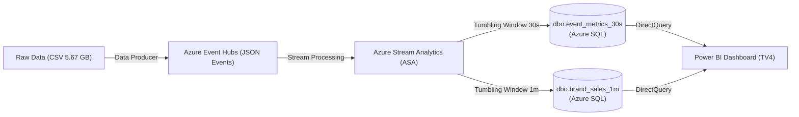

# 03 – Cơ sở dữ liệu, lưu trữ cloud & hiệu năng (TV3)

> Template bám rubric. Điền bằng số liệu thật từ repo. Mọi bảng/hình có số + chú thích; nguồn ở mục 8. Ảnh trong `evidence/azure-sql/`.

## 1. Loại dữ liệu và bài toán lưu trữ  *(rubric 1.2)*
- **Dữ liệu nguồn:** Tệp CSV kích thước 5.67 GB gồm 9 cột, tổng cộng **42.448.764 sự kiện** hành vi người dùng (tháng 10/2019). Dữ liệu được TV1 (Data Producer) đọc theo khối, đóng gói thành dạng **bán cấu trúc (semi-structured JSON event)** và truyền phát qua Azure Event Hubs theo thời gian thực.
- **Dữ liệu đích phục vụ phân tích:** Sau khi đi qua Azure Stream Analytics (TV2) với các cửa sổ thời gian (tumbling window 30 giây và 1 phút), dữ liệu được tổng hợp thành dạng **có cấu trúc (structured tabular)** và ghi vào 2 bảng quan hệ trên Azure SQL Database (`dbo.event_metrics_30s` và `dbo.brand_sales_1m`). Thiết kế này giúp Power BI Desktop (TV4) truy vấn trực tiếp (DirectQuery) với độ trễ thấp và tải tính toán nhẹ.
- **Vai trò kết hợp giữa Azure SQL Database và Azure Blob Storage:**
  - *Azure SQL Database:* Đóng vai trò là kho dữ liệu phân tích vận hành (Operational Data Store), tối ưu hóa cho các truy vấn tổng hợp theo thời gian thực, lọc theo chỉ mục `(window_end, run_id)`, và phục vụ bảng điều khiển tương tác.
  - *Azure Blob Storage:* Đóng vai trò là hồ chứa dữ liệu (Object Storage / Data Lake) chi phí thấp, dùng để lưu trữ các tập dữ liệu mẫu tĩnh, kết quả đo benchmark, log kiểm thử hệ thống và dữ liệu sao lưu lâu dài.
- **Giới hạn nghiệp vụ của dữ liệu:** Tập dữ liệu hành vi người dùng không có trường `order_id` (mã đơn hàng), do đó sự kiện `purchase` được định nghĩa chính xác là **"sự kiện mua hàng" (purchase event)**, không đồng nhất với một "đơn hàng" trọn vẹn; chỉ số doanh thu (`revenue`) là tổng giá trị `price` của các purchase event.

## 2. Dịch vụ cloud TV3 thuộc nhóm nào  *(rubric 1.4)*
| Dịch vụ | Nhóm mô hình | Lý do phân loại theo trách nhiệm chia sẻ (Shared Responsibility) |
|---|---|---|
| **Azure SQL Database** | **PaaS** *(Platform as a Service)* | Microsoft chịu trách nhiệm toàn bộ về phần cứng, hệ điều hành, cài đặt SQL engine, vá lỗi bảo mật, tự động sao lưu và bảo đảm tính sẵn sàng cao (High Availability). Người dùng (TV3) chỉ tập trung thiết kế lược đồ (schema), tạo chỉ mục (index), quản lý người dùng và tối ưu hóa câu lệnh truy vấn. |
| **Azure Blob Storage** | **PaaS** *(Storage as a Service)* | Dịch vụ lưu trữ đối tượng phi cấu trúc được quản lý hoàn toàn. Microsoft quản lý hạ tầng lưu trữ vật lý, phân vùng, mã hóa dữ liệu khi nghỉ (encryption-at-rest) và sao lưu cục bộ (LRS). Người dùng chỉ quản lý container, đối tượng blob, chính sách truy cập (Access Tier) và khóa truy cập (SAS token). |
| **Azure Virtual Machine** *(Dùng đo latency T9)* | **IaaS** *(Infrastructure as a Service)* | Microsoft chỉ cung cấp hạ tầng phần cứng ảo hóa và mạng. Người dùng (TV3) phải tự cấu hình hệ điều hành (Ubuntu 22.04 LTS), cài đặt thư viện (`msodbcsql18`, Python runtime), cấu hình tường lửa (NSG) và quản lý tiến trình ứng dụng. |
| **Power BI Service** *(TV4 sử dụng)* | **SaaS** *(Software as a Service)* | Ứng dụng phân tích và trực quan hóa dữ liệu hoàn chỉnh chạy trên nền web. Người dùng chỉ sử dụng giao diện phần mềm để xem và tương tác với báo cáo, không quản lý bất kỳ nền tảng hay hạ tầng máy chủ nào. |

## 3. Cơ sở lý thuyết: định dạng lưu trữ  *(rubric 2.1)*

### 3.1 So sánh các định dạng lưu trữ
| Tiêu chí | CSV (Phẳng / Văn bản) | JSON (Bán cấu trúc) | Bảng quan hệ RDBMS (SQL) | Đối tượng Blob (Object) |
|---|---|---|---|---|
| **Cấu trúc dữ liệu** | Có cấu trúc đơn giản, dạng dòng/cột phân tách bởi dấu phẩy | Bán cấu trúc, hỗ trợ lồng nhau (key-value, array) | Có cấu trúc chặt chẽ, định nghĩa schema tĩnh và ràng buộc toàn vẹn | Phi cấu trúc (unstructured binary/text) |
| **Dung lượng lưu trữ** | Trung bình, lặp lại header và dữ liệu dạng chuỗi văn bản | Lớn do lặp lại các tên khóa (field keys) trong từng bản ghi | Tối ưu nhờ lưu trữ nhị phân kiểu dữ liệu gốc (DATETIME2, BIGINT, FLOAT) | Tối ưu chi phí lưu trữ cho tệp kích thước lớn |
| **Tốc độ đọc truy vấn** | Chậm (phải quét tuần tự toàn bộ tệp, phân tích chuỗi) | Chậm khi lọc/tìm kiếm trên tập dữ liệu lớn nếu không có chỉ mục | Siêu nhanh nhờ cấu trúc B-tree Index, Clustered Index và bộ nhớ đệm | Nhanh khi tải toàn bộ tệp (Streaming read); không hỗ trợ lọc nội dòng |
| **Ràng buộc & Toàn vẹn** | Không có cơ chế ép kiểu hoặc kiểm tra ràng buộc | Kiểm tra thông qua JSON Schema ở tầng ứng dụng | Ràng buộc kiểu dữ liệu mạnh mẽ (`NOT NULL`, `CHECK`, kiểu số/ngày) | Không quản lý ràng buộc bên trong đối tượng |
| **Trường hợp sử dụng phù hợp** | Xuất nhập dữ liệu hàng loạt giữa các hệ thống | Trao đổi dữ liệu streaming qua message bus (Event Hubs) | Phân tích OLAP/OLTP, bảng điều khiển BI đòi hỏi truy vấn tức thời | Lưu trữ dữ liệu hồ (Data Lake), tệp sao lưu, log, ảnh minh chứng |

### 3.2 Ứng dụng thực tế trong kiến trúc hệ thống
Trong đồ án, nhóm phối hợp linh hoạt cả 4 định dạng theo đúng vòng đời dữ liệu:
1. **Dữ liệu gốc (CSV):** Lưu trữ tệp tĩnh 5.67 GB tại máy trạm của Producer để đọc theo khối.
2. **Dữ liệu truyền phát (JSON):** Chuyển đổi từng bản ghi CSV thành gói tin JSON chuẩn hóa tuân thủ `data_contract.json` để truyền qua Event Hubs, cho phép mở rộng linh hoạt mà không phá vỡ đường truyền.
3. **Dữ liệu tổng hợp (SQL RDBMS):** Lưu trữ kết quả sau khi xử lý streaming vào 2 bảng `event_metrics_30s` và `brand_sales_1m` với chỉ mục `(window_end, run_id)`, tối ưu hóa truy vấn cho Power BI.
4. **Dữ liệu đo lường (Blob Object):** Lưu trữ các tệp kết quả benchmark CSV và báo cáo đo lường độc lập trên Azure Blob Storage.

## 4. Cơ sở lý thuyết: dịch vụ cloud sử dụng  *(rubric 2.3)*

### 4.1 Azure SQL Database
- **Mô hình tính toán DTU (Database Transaction Unit):** DTU là đơn vị đo lường năng lực tính toán kết hợp đồng thời giữa CPU, Bộ nhớ (Memory), và Tốc độ đọc/ghi dữ liệu (Data & Log I/O). Trong đồ án:
  - *Giai đoạn Sprint 1 (Kiểm thử & Phát triển):* Sử dụng gói **Basic (5 DTU)** nhằm tiết kiệm chi phí tối đa (~$4.90/tháng).
  - *Giai đoạn Sprint 2 (Đo tải Benchmark):* Nâng cấp lên gói **Standard S1 (20 DTU)** để đảm bảo thông lượng ghi log liên tục và không bị hiện tượng tự động ngủ (auto-pause) làm sai lệch độ trễ.
- **Cơ chế sao lưu và tính dự phòng:** Sử dụng gói sao lưu cục bộ **Locally-Redundant Storage (LRS)** giúp nhân bản 3 bản sao dữ liệu trong cùng một trung tâm dữ liệu tại region **East Asia**, vừa đảm bảo an toàn dữ liệu vừa tối ưu chi phí.
- **An toàn và Bảo mật truy cập (Security & Least Privilege):**
  - Tường lửa (Firewall) đóng hoàn toàn theo mặc định, chỉ mở cổng cho các địa chỉ IP cụ thể của nhóm và kích hoạt ngoại lệ cho các dịch vụ nội bộ Azure (*Allow Azure services and resources to access this server*).
  - Áp dụng nguyên tắc quyền tối thiểu (Least Privilege) với 2 tài khoản chuyên biệt: `asa_writer` (chỉ có quyền `SELECT, INSERT` để ghi dữ liệu streaming) và `pbi_reader` (chỉ có quyền `SELECT` để đọc dữ liệu báo cáo).
- **Giám sát hiệu năng thông qua Dynamic Management Views (DMV):** Sử dụng view hệ thống `sys.dm_db_resource_stats` để theo dõi mức độ tiêu thụ DTU trung bình theo từng chu kỳ 15 giây, hỗ trợ phân tích điểm nghẽn hiệu năng khi chạy thử tải.

### 4.2 Azure Blob Storage
- **Kiến trúc phân cấp:** Gồm Tài khoản lưu trữ (*Storage Account* `stsalesgr03tram01`) chứa các Thùng chứa (*Container* `benchmark-data`), bên trong chứa các Khối dữ liệu nhị phân (*Block Blobs*).
- **Mức truy cập (Access Tier):** Sử dụng tầng **Hot** cho các tệp dữ liệu kiểm thử và benchmark cần truy xuất ngay lập tức.
- **Kiểm soát truy cập an toàn:** Container được cấu hình ở chế độ riêng tư (**Private**). Khi công cụ đo kiểm (`azcopy`) cần tải tệp lên, hệ thống cấp phát Chữ ký truy cập dùng chung (**Shared Access Signature - SAS Token**) với quyền hạn tối thiểu và thời hạn hết hạn ngắn.

### 4.3 Quản lý chi phí (Cost Management & Quotas)
- **Cảnh báo ngân sách (Budget Alert):** Thiết lập ngân sách kiểm soát chi phí nhóm ở mức $20–$30/tháng, tự động gửi cảnh báo qua email khi chi phí thực tế (*Actual cost*) chạm các ngưỡng 50%, 80%, và 100%.
- **Giám sát hạn mức (Quotas):** Đăng ký đầy đủ Resource Provider `Microsoft.Sql` và `Microsoft.Compute` để theo dõi chính xác hạn mức vCPU và tài nguyên cho phép của gói Azure for Students.

## 5. Mô hình dữ liệu và kiến trúc lưu trữ

### 5.1 Kiến trúc luồng dữ liệu tổng thể

### 5.2 Lược đồ cơ sở dữ liệu quan hệ (Relational Schema)
Hệ thống sử dụng hai bảng quan hệ chính được chuẩn hóa theo hợp đồng dữ liệu đóng băng (Data Contract Freeze v1 ngày 08/11/2026):

#### 1. Bảng tổng hợp sự kiện 30 giây (`dbo.event_metrics_30s`)
Lưu trữ số lượng từng loại sự kiện và doanh thu mua hàng được tổng hợp theo từng cửa sổ trượt 30 giây:
* `window_end` (`DATETIME2`, NOT NULL): Mốc thời gian kết thúc cửa sổ tính theo chuẩn UTC từ hàm `System.Timestamp()` của Stream Analytics.
* `run_id` (`NVARCHAR(50)`, NOT NULL): Mã định danh đợt truyền dữ liệu (ví dụ: `mock-seed`, `integration-01`), dùng để phân tách và lọc độc lập từng phiên chạy.
* `event_type` (`NVARCHAR(30)`, NOT NULL): Loại tương tác người dùng (`view`, `cart`, `remove_from_cart`, `purchase`).
* `event_count` (`BIGINT`, NOT NULL): Tổng số sự kiện phát sinh trong cửa sổ 30 giây tương ứng.
* `revenue` (`FLOAT`, NOT NULL): Tổng giá trị `price` của các sự kiện `purchase` trong cửa sổ (bằng 0 đối với các loại sự kiện khác).

#### 2. Bảng doanh thu thương hiệu 1 phút (`dbo.brand_sales_1m`)
Lưu trữ thông lượng mua hàng và doanh thu theo từng nhãn hàng trong cửa sổ 1 phút:
* `window_end` (`DATETIME2`, NOT NULL): Mốc thời gian kết thúc cửa sổ 1 phút (UTC).
* `run_id` (`NVARCHAR(50)`, NOT NULL): Mã đợt chạy phân tích.
* `brand` (`NVARCHAR(200)`, NOT NULL): Tên thương hiệu sản phẩm. Đối với các bản ghi thiếu nhãn hiệu, hệ thống chuẩn hóa bắt buộc thành `'unknown'` bằng hàm `COALESCE(brand, 'unknown')`.
* `purchase_events` (`BIGINT`, NOT NULL): Tổng số lần phát sinh hành vi mua hàng của thương hiệu trong 1 phút.
* `revenue` (`FLOAT`, NOT NULL): Tổng doanh số bán ra của thương hiệu trong cửa sổ 1 phút.

### 5.3 Chiến lược đánh chỉ mục (Indexing Strategy)
Nhằm tối ưu hóa hiệu năng truy vấn trong chế độ DirectQuery của Power BI và hỗ trợ các truy vấn kiểm định, hệ thống thiết lập 2 Non-Clustered Index:
* `ix_event_metrics_30s_window_run` trên bảng `dbo.event_metrics_30s (window_end, run_id)`
* `ix_brand_sales_1m_window_run` trên bảng `dbo.brand_sales_1m (window_end, run_id)`

**Lý do thiết kế:**
1. **Tối ưu lọc thời gian thực:** Power BI liên tục gửi các câu truy vấn dạng `WHERE window_end >= DATEADD(minute, -15, SYSUTCDATETIME()) AND run_id = @run` để vẽ biểu đồ xu hướng. Cặp chỉ mục `(window_end, run_id)` giúp bộ tối ưu hóa truy vấn (Query Optimizer) thực hiện phép quét vùng chỉ mục (Index Seek) thay vì phải quét toàn bộ bảng (Table Scan).
2. **Kiểm soát chi phí ghi:** Chỉ duy trì đúng 1 chỉ mục phụ trên mỗi bảng để tránh gây áp lực ghi log I/O lên Azure SQL Database trong suốt quá trình nhận dòng dữ liệu streaming với tần suất cao.

### 5.4 Cơ chế cô lập dữ liệu thử nghiệm (`run_id`)
* **Dữ liệu giả lập (`mock-seed`):** Được nạp vào ban đầu bằng tập lệnh `seed_data.sql` để mô phỏng 60 phút hoạt động gần nhất, giúp TV4 thiết kế và kiểm thử giao diện Power BI trước khi đường truyền hoàn tất.
* **Dữ liệu tích hợp thật (`integration-01`):** Khi hệ thống chạy thật, dữ liệu được gắn cờ đợt chạy riêng biệt. Bảng điều khiển và các câu lệnh kiểm định lọc dữ liệu theo `run_id` tương ứng, loại bỏ nguy cơ lẫn lộn dữ liệu mà không cần phải xóa hoặc tạo lại bảng.

## 6. Kết quả đo  *(rubric 3.1, 3.3)*
### 6.1 Tốc độ đọc/ghi theo dung lượng
Môi trường: [ĐIỀN]. Phương pháp: `sql_benchmark.py` (nêu suite, mốc dung lượng, số lần lặp). Bảng + biểu đồ `read_scan_time.png`, `write_throughput.png`: [ĐIỀN].
### 6.2 Máy chủ truyền thống (SQL Server local) vs cloud (Azure SQL)  *(rubric 1.3)*
Cấu hình hai bên (CPU/RAM/ổ đĩa/tier) và kết quả cùng workload: [ĐIỀN]. **Giới hạn khoa học**: khác phần cứng, phiên bản, mạng; không khẳng định chênh lệch thuần của "cloud vs on-premise".
### 6.3 Độ trễ khác region
Thiết kế phép đo (1 client, 2 server, xen kẽ; tcp/ping/query/login; p50/p95; n mẫu; ≥2 lượt): [ĐIỀN]. Bảng + `region_latency.png`. Hạn chế: [ĐIỀN].
### 6.4 Blob upload/download
`blob_transfer_results.csv`: [ĐIỀN].
### 6.5 Độ trễ cập nhật pipeline
`lag_seconds` (khối [7]) cho run [ĐIỀN]: [ĐIỀN]; phụ thuộc cửa sổ ASA 30s/1m + ghi SQL + refresh Power BI.

## 7. Tối ưu  *(rubric 3.4)*
Tóm tắt từ `database/benchmarks/optimization.md` (bảng trước/sau) + khuyến nghị. Chi phí & quota: tóm tắt từ `cloud_cost_report.md` (bảng + ảnh Cost analysis).
Đối chiếu tính đúng: `validation_integration-01.txt` [ĐIỀN: PASS / lệch + giải thích].

## 8. Quản lý tài nguyên nhóm
Resource group chung, IAM 4 thành viên (`08_iam_role_assignments.png`), budget alert, quy trình dọn dẹp.

## 9. Kết luận, hạn chế, hướng cải tiến
[ĐIỀN]

## Tài liệu tham khảo
- Azure SQL Database – DTU-based purchasing model (Microsoft Learn): https://learn.microsoft.com/azure/azure-sql/database/service-tiers-dtu
- sys.dm_db_resource_stats (Azure SQL Database System DMV - Microsoft Learn): https://learn.microsoft.com/sql/relational-databases/system-dynamic-management-views/sys-dm-db-resource-stats-azure-sql-database
- Azure Blob Storage introduction & data redundancy (Microsoft Learn): https://learn.microsoft.com/azure/storage/blobs/storage-blobs-introduction
- Azure Cost Management create and manage budgets (Microsoft Learn): https://learn.microsoft.com/azure/cost-management-billing/costs/tutorial-acm-create-budgets
- Dataset Kaggle eCommerce Behavior Data from Multi Category Store (Michael Kechinov, 2019): https://www.kaggle.com/datasets/mkechinov/ecommerce-behavior-data-from-multi-category-store
